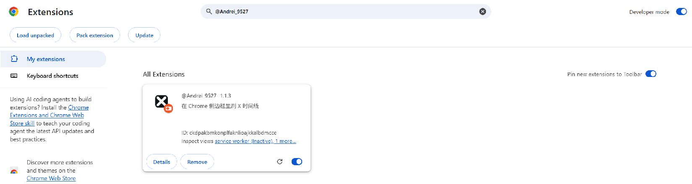
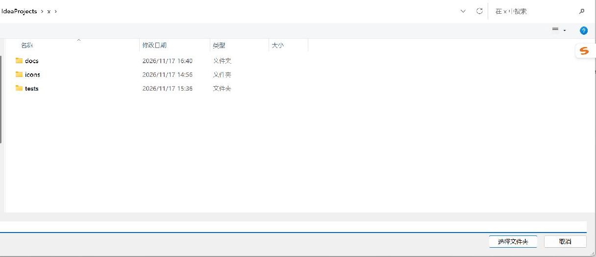
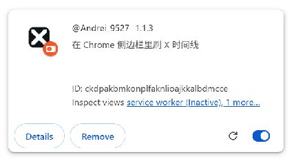

# @Andrei_9527

[中文](README.md)

Browse X in the Chrome side panel, with a day/night theme, layout zoom, and following and follower stats. Requires **Chrome 145+** and access to X. See the [user guide](docs/user-guide.en.md).

## Install

1. Download the project and extract it to a permanent folder. Confirm that `manifest.json` is in that folder. No dependencies or local server are required.

2. Open `chrome://extensions/`, turn on **Developer mode** in the upper right, then click **Load unpacked**.

   

3. Select the **project root** that contains `manifest.json`, then click **Select Folder**. Do not select the ZIP file, or the `icons`, `docs`, or `tests` subfolders. The folder picker may show only folders and hide `manifest.json`. That is expected.

   

4. Installation is complete when the **@Andrei_9527** card appears and its switch is on.

   

5. Open [x.com](https://x.com) in a normal tab and sign in. Then open the side panel from the Chrome toolbar extensions menu by choosing **@Andrei_9527**, or press `Alt+Shift+X`. If the panel stays blank right after sign-in, confirm that x.com is signed in in that tab, then click **首页** (Home) in the side panel.

## Language

When the side panel opens, the extension sets X’s interface to the browser’s language and refreshes the timeline. If you are signed in, this updates that X account’s display language. The language menu uses the same choices as X. Choosing another language switches both X and the side panel.

The side panel’s own text is available in Simplified Chinese, Traditional Chinese, and English. For any other choice, X switches to that language and the side panel text stays in English.

## Following and followers

The side panel labels are in Chinese:

| Label | Meaning |
| --- | --- |
| 粉丝管理 | Followers |
| 立即同步 | Sync now |
| 未回关 | Not following back |
| 取关 | Unfollowed |
| 已忽略 | Ignored |
| 忽略 / 取消忽略 | Ignore / Stop ignoring |

- After signing in to X in Chrome, open **粉丝管理** (Followers) in the side panel and click **立即同步** (Sync now). The panel scrolls the following and followers pages and compares the lists on this computer. Sync uses your X web session. It does not use a developer API quota and does not open a new tab. Keep the side panel open while it runs. The same X account can sync again only 1 hour after a successful sync. A failed or incomplete read does not start that hour. The button shows the remaining time, and closing the side panel does not reset it.
- The extension reads the rate-limit headers from the list requests in that sync. When two or fewer requests remain, scrolling pauses until the reset time X returns, then continues on the list page that is already open.
- The follower snapshot, the not-following-back list, the unfollow list, and the daily counts are stored on this computer per X account. Syncing more than once on the same day updates that day's record.
- **未回关至少 N 天** (Not following back for at least N days) starts on the day the first sync finds that the account does not follow you back, and runs through the latest successful sync. If a later sync finds that they follow you back, and a sync after that finds that they do not, the count starts over.
- **忽略** (Ignore) next to a user hides that user from both **未回关** (Not following back) and **取关** (Unfollowed). The ignore list is stored on this computer for the current X account. Undo it under **已忽略** (Ignored).
- Each row shows the display name and `@handle` read during that sync. A row without a display name shows the `@handle`.
- **取关** (Unfollowed) compares follower lists by X user ID and shows the date it was found (China Standard Time, UTC+8). The first web sync sets the baseline. If that account follows you again, it leaves the unfollow list. Counts include only users that were actually read. If the follower list loads only in part, this sync does not record new unfollows.

## Risk

> This is a third-party tool and is not affiliated with X. To load X in the side panel, the extension changes embedding restrictions and some request headers. That can trigger account verification, feature limits, or suspension. **Account safety is not guaranteed.**
>
> Use the official X website or app for important accounts. If X asks you to verify the account or limits it, stop using this extension and follow X's instructions. See the [X Terms of Service](https://x.com/en/tos).

[MIT License](LICENSE)
