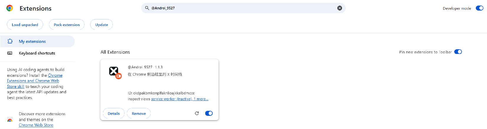
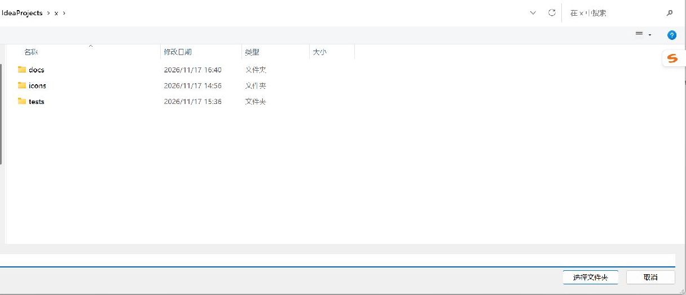
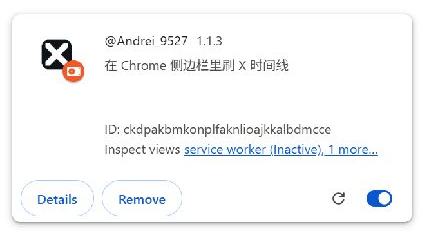

# @Andrei_9527

在 Chrome 侧栏浏览 X，支持日间 / 夜间切换和布局缩放。需要 **Chrome 145+**，并能正常访问 X。

## 安装

1. 下载项目并解压到固定目录，确认目录中有 `manifest.json`。无需安装依赖或启动服务。

2. 在 Chrome 地址栏输入 `chrome://extensions/`，打开右上角 **开发者模式（Developer mode）**，再点击 **加载已解压的扩展程序（Load unpacked）**。

   

3. 选择包含 `manifest.json` 的**项目根目录**，点击 **选择文件夹**。不要选 ZIP 文件，也不要选 `icons`、`docs` 或 `tests` 子目录。目录选择器可能只显示文件夹，不显示 `manifest.json`，这是正常现象。

   

4. 出现 **@Andrei_9527** 卡片且开关处于启用状态，即表示已安装。

   

5. 在普通页签打开 [x.com](https://x.com) 并登录，再通过 Chrome 工具栏的扩展菜单选择 **@Andrei_9527** 打开侧栏；也可按 `Alt+Shift+X`。刚登录后若未加载，点击侧栏「刷新」。

## 风险提示

> 本项目是第三方工具，与 X 官方无隶属关系。为在侧栏加载 X，扩展会修改嵌入限制及部分请求头，存在触发账号验证、功能限制乃至封禁的风险，**无法保证账号安全**。
>
> 重要账号建议使用 X 官方网页或 App。出现验证或账号受限时，应停止使用并按 X 官方提示处理。参见 [X 服务条款](https://x.com/en/tos)。

[MIT License](LICENSE)
